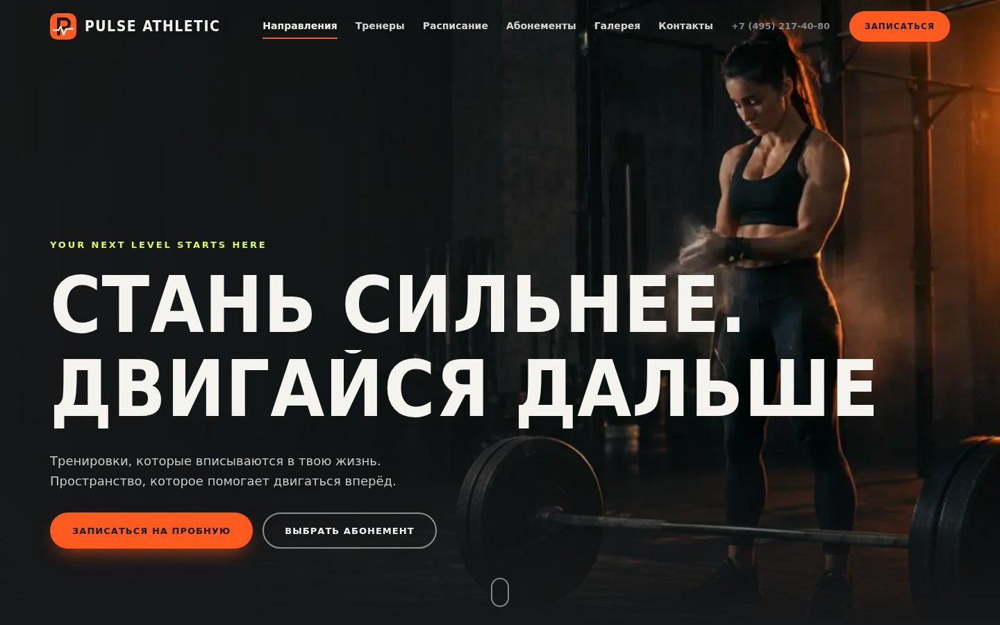
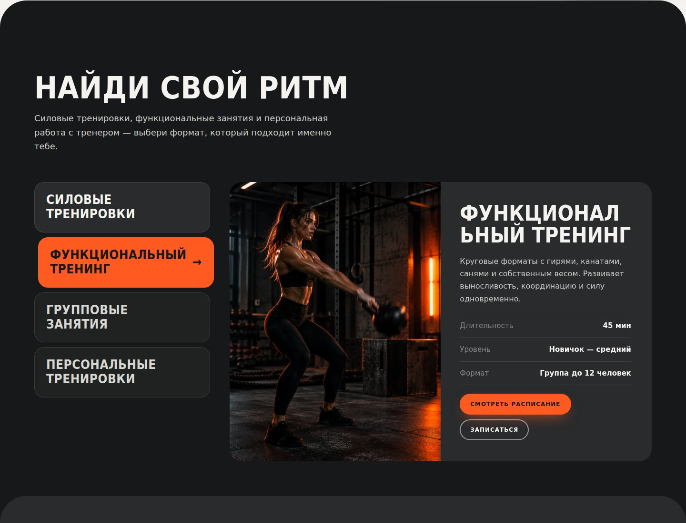
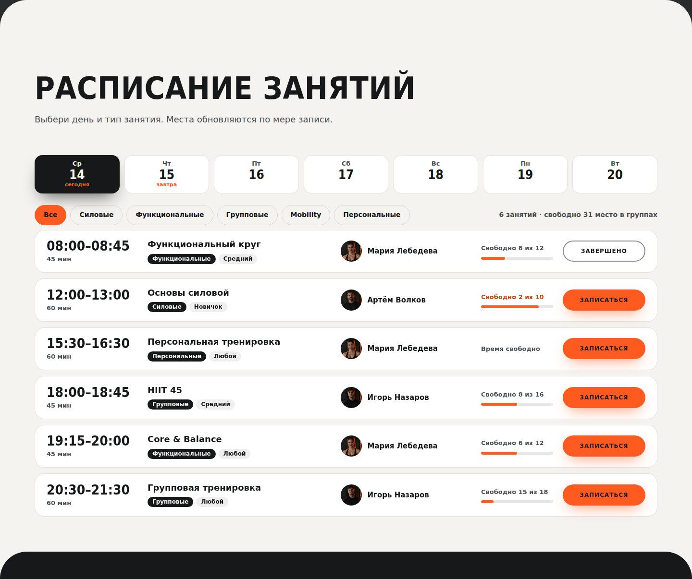
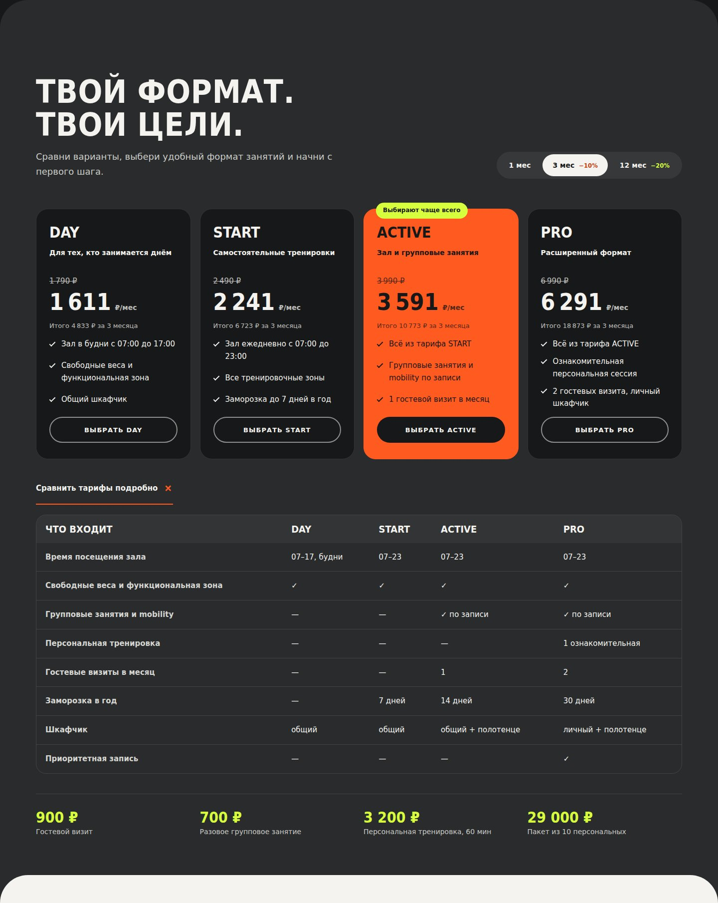
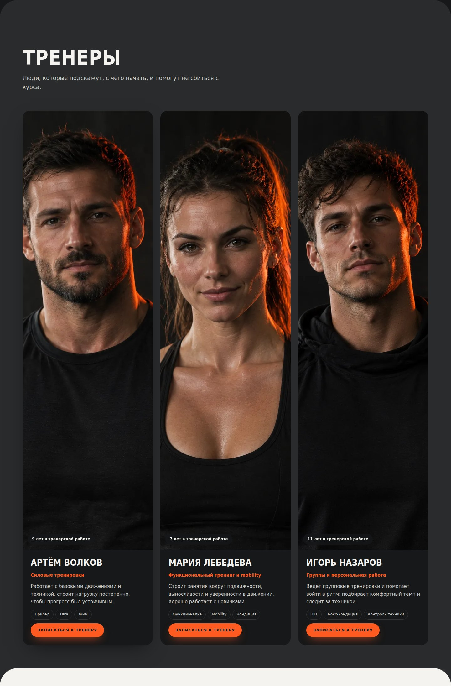
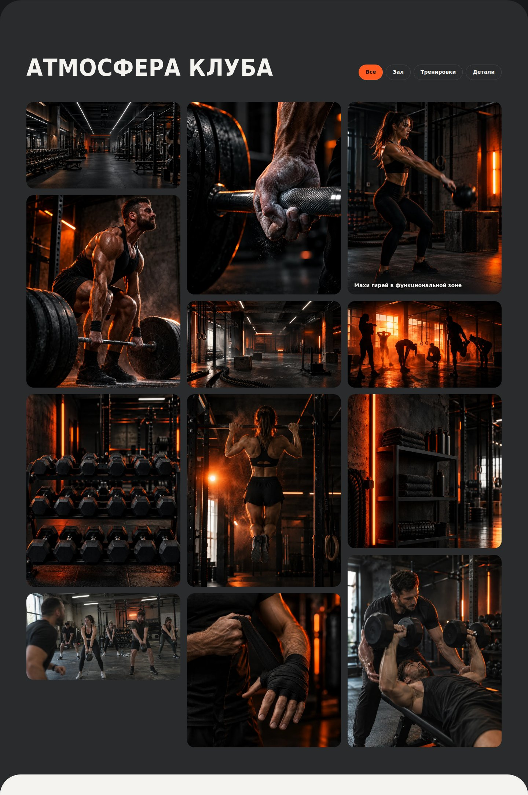
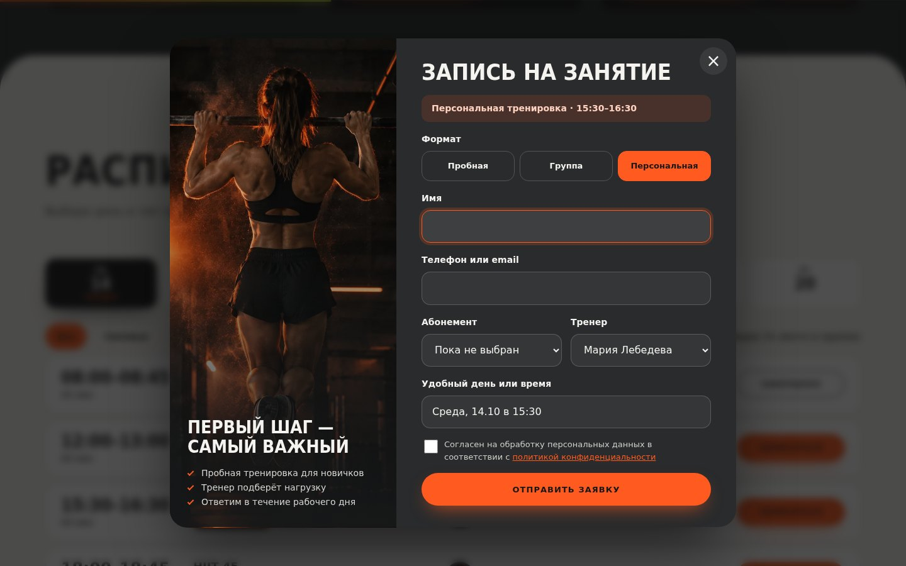
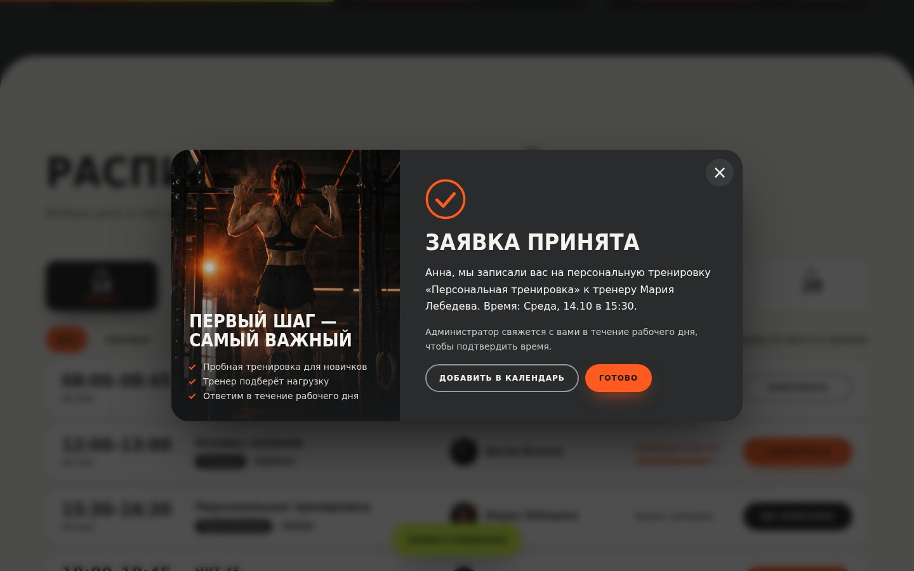
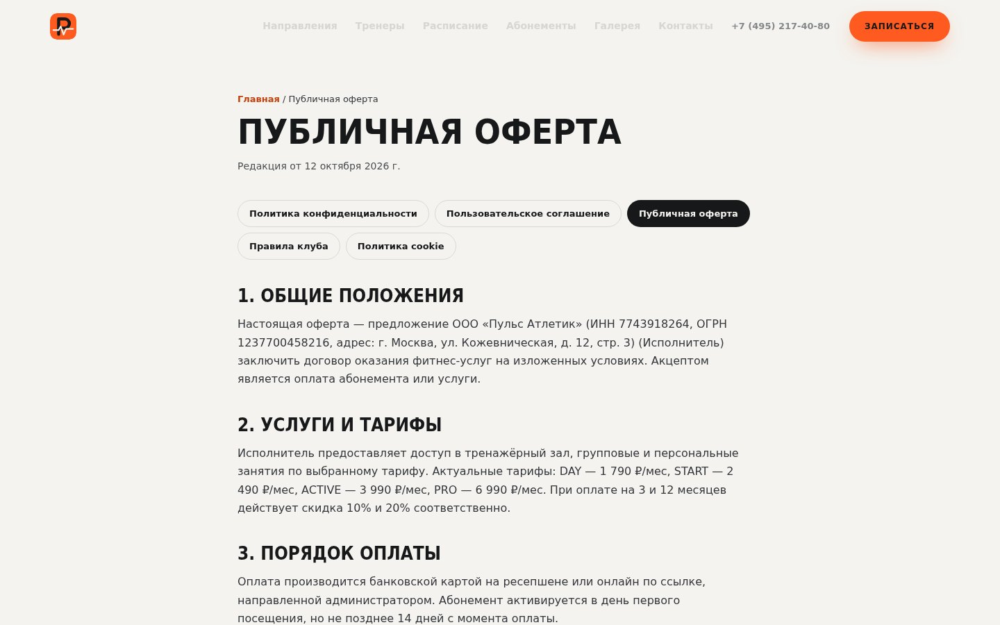
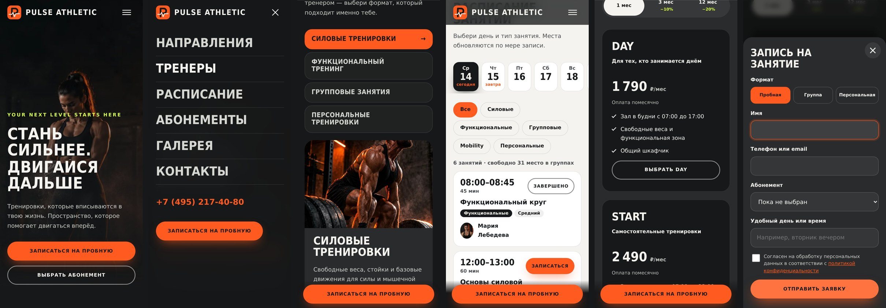

<div align="center">


# PULSE ATHLETIC

**Сайт городского фитнес-клуба: расписание с записью, тарифы, тренеры и галерея**




</div>

> **Концептуальный проект для портфолио.** Бренд, тарифы, тренеры, расписание, контакты и реквизиты вымышлены. Фотографии и видео созданы нейросетью. Формы работают только в браузере, данные никуда не отправляются.

## Содержание

- [Возможности](#возможности)
- [Скриншоты](#скриншоты)
- [Технологии](#технологии)
- [Быстрый старт](#быстрый-старт)
- [Структура проекта](#структура-проекта)
- [Как менять контент](#как-менять-контент)
- [Публикация](#публикация)
- [Адаптивность](#адаптивность)
- [Доступность и SEO](#доступность-и-seo)
- [Что нужно для боевого запуска](#что-нужно-для-боевого-запуска)
- [Лицензия](#лицензия)

## Возможности

**Страницы.** Главная, политика конфиденциальности, пользовательское соглашение, публичная оферта, правила клуба, политика cookie и страница 404.

**Главная страница**

| Блок | Что умеет |
| --- | --- |
| Первый экран | Видеофон, плавное появление заголовка, параллакс, счётчики цифр клуба, бегущая строка направлений |
| Направления | Интерактивные вкладки с большими фото, описанием и переходом в расписание с нужным фильтром |
| Тренеры | Карточки с фото и специализацией, запись к выбранному тренеру |
| Расписание | Реальные даты на 7 дней вперёд, фильтры по типу, свободные места, статус «Вы записаны», завершённые занятия |
| Абонементы | 4 тарифа, переключатель срока (1 / 3 / 12 месяцев со скидкой), таблица сравнения, дополнительные услуги |
| Подбор формата | Мини-опрос из трёх вопросов с рекомендацией тарифа и переходом к записи |
| Галерея | Фильтр по категориям, фото в родных пропорциях, лайтбокс с клавиатурой и свайпом |
| Отзывы | Карусель с прокруткой стрелками и клавиатурой |
| FAQ | Аккордеон с плавной анимацией и управлением стрелками |
| Контакты | Копирование адреса, телефона и почты, форма обратной связи |
| Запись | Модальное окно с проверкой полей, подтверждением и экспортом занятия в календарь (.ics) |
| Прочее | Баннер cookie, индикатор прокрутки, закреплённая кнопка записи на телефоне |

## Скриншоты

<table>
  <tr>
    <td width="50%"><br><sub>Направления</sub></td>
    <td width="50%"><br><sub>Расписание с датами и свободными местами</sub></td>
  </tr>
  <tr>
    <td><br><sub>Абонементы и сравнение тарифов</sub></td>
    <td><br><sub>Тренеры</sub></td>
  </tr>
  <tr>
    <td><br><sub>Галерея с фильтрами</sub></td>
    <td><br><sub>Окно записи</sub></td>
  </tr>
  <tr>
    <td><br><sub>Подтверждение и экспорт в календарь</sub></td>
    <td><br><sub>Юридические страницы</sub></td>
  </tr>
</table>

**Мобильная версия**



> Скриншоты сняты в среде без доступа к Google Fonts, поэтому вместо Oswald и Manrope использованы системные шрифты. С подключёнными шрифтами заголовки выглядят уже и аккуратнее.

## Технологии

- **HTML5**: семантическая разметка, структурированные данные JSON-LD, Open Graph.
- **CSS3**: переменные, `grid`, `flex`, `clamp()`, `:has()`, анимации на `transform` и `opacity`.
- **JavaScript (ES-модули)**: без фреймворков, код разделён по назначению.
- **Vite 5**: быстрая разработка и многостраничная сборка.
- **Шрифты**: Oswald (заголовки) и Manrope (текст) через Google Fonts.

## Быстрый старт

Нужен Node.js 18 или новее (в `.nvmrc` указана 20).

```bash
git clone <адрес-репозитория>
cd pulse-athletic
npm install
npm run dev
```

Сайт откроется по адресу, который покажет Vite (обычно `http://localhost:5173`).

| Команда | Что делает |
| --- | --- |
| `npm run dev` | Запускает сервер разработки |
| `npm run build` | Собирает сайт в папку `dist/` |
| `npm run preview` | Запускает локальный просмотр собранной версии |
| `npm run check` | Проверяет страницы: дубликаты `id`, битые якоря, пропавшие файлы, `alt` у изображений |
| `npm run verify` | Выполняет `check` и `build` (используется в CI) |

После первой установки закоммитьте `package-lock.json`: это даст воспроизводимые сборки.

## Структура проекта

```text
pulse-athletic/
├── .github/workflows/deploy.yml   # сборка и публикация на GitHub Pages
├── docs/screenshots/              # скриншоты для README
├── public/                        # статика: изображения, видео, иконки, robots.txt, sitemap.xml
│   ├── images/                    # WebP-фото и OG-превью
│   └── video/                     # сжатые mp4 для фона
├── src/
│   ├── scripts/
│   │   ├── data.js                # расписание, тарифы, галерея
│   │   ├── navigation.js          # меню, шапка, подсветка раздела
│   │   ├── schedule.js            # дни, фильтры, места, запись
│   │   ├── memberships.js         # срок абонемента, сравнение
│   │   ├── directions.js          # вкладки направлений
│   │   ├── quiz.js                # подбор формата
│   │   ├── booking.js             # окно записи, проверка, .ics
│   │   ├── gallery.js             # галерея и лайтбокс
│   │   ├── reviews.js, faq.js     # карусель и аккордеон
│   │   ├── animations.js          # появление блоков, счётчики, параллакс
│   │   ├── extras.js              # cookie, копирование, форма обратной связи
│   │   └── validators.js          # проверка контактов, уведомления
│   ├── styles/                    # variables, base, layout, components, responsive
│   ├── main.js                    # точка входа главной страницы
│   └── legal.js                   # точка входа документов
├── tools/check.mjs                # проверка страниц без зависимостей
├── index.html                     # главная
├── privacy.html, terms.html, offer.html, rules.html, cookies.html, 404.html
├── vite.config.js                 # многостраничная сборка, относительные пути
└── .env                           # VITE_SITE_URL для canonical и Open Graph
```

## Как менять контент

- **Расписание.** В `src/scripts/data.js` массив `WEEK`: по семь дней, в каждом занятия вида `[тип, название, начало, минуты, тренер, уровень, мест]`. Даты подставляются автоматически от сегодняшнего дня.
- **Цены.** Объект `PLANS` и скидки в `PERIODS` в `data.js`. Тексты тарифов и таблица сравнения лежат в `index.html`.
- **Галерея.** Массив `SHOTS` в `data.js`: имя файла, категория, размеры и подпись.
- **Тексты, контакты и реквизиты.** Прямо в HTML. Реквизиты повторяются в подвале и в юридических страницах, поэтому при замене проверьте все файлы (поиск по `7743918264`).
- **Цвета и размеры.** Переменные в `src/styles/variables.css`.
- **Домен.** В `.env` значение `VITE_SITE_URL`. Также замените домен в `public/robots.txt` и `public/sitemap.xml`.

## Публикация

**GitHub Pages.** Включите Pages в настройках репозитория (источник: GitHub Actions) и отправьте код в ветку `main`. Workflow `.github/workflows/deploy.yml` соберёт и опубликует сайт. Пути в сборке относительные, поэтому адрес вида `user.github.io/repo/` работает без настройки.

**Netlify, Vercel, Cloudflare Pages.** Команда сборки `npm run build`, папка публикации `dist`.

## Адаптивность

Проверено на 16 размерах экрана от 320 до 1920 px, включая ландшафтные телефоны: нет горизонтальной прокрутки, обрезанного текста и ошибок в консоли.

| Ширина | Поведение |
| --- | --- |
| от 1360 px | Полная шапка с телефоном |
| до 1100 px | Меню-бургер на весь экран, кнопка записи внутри |
| до 1024 px | Направления и тренеры перестраиваются, галерея в 2 колонки |
| до 900 px | Расписание превращается в карточки, окно записи без боковой картинки |
| до 700 px | Закреплённая кнопка записи, окно записи выезжает снизу |
| до 374 px | Компактные заголовки и одноколоночные списки |

## Доступность и SEO

- Ссылка «К содержимому», один `h1` на странице, логичная иерархия заголовков и ориентиры (`header`, `nav`, `main`, `footer`).
- Вкладки, аккордеон, переключатель срока и карусель управляются с клавиатуры. Диалоги используют нативный `<dialog>` с захватом фокуса.
- Видимый фокус, подписи и сообщения об ошибках у полей формы.
- Поддержка `prefers-reduced-motion`: анимации и автовоспроизведение видео отключаются.
- Изображения в WebP, ленивая загрузка ниже первого экрана, приоритет у главного изображения, видео ставится на паузу вне экрана.
- Уникальные `title` и `description`, Open Graph, canonical, JSON-LD, `robots.txt`, `sitemap.xml`, иконки и манифест.

Показатели Lighthouse в этой версии не измерялись. Запустите проверку на опубликованной странице и сравните с целями: Performance 90+, Accessibility 95+, Best Practices 95+, SEO 90+.

## Что нужно для боевого запуска

1. **Приём заявок.** Формы в `booking.js` и `extras.js` проверяют данные и показывают подтверждение, но не отправляют их. Подключите backend или сервис форм.
2. **Данные клуба.** Замените вымышленные адрес, телефон, почту, реквизиты и тексты юридических документов на реальные. Юридические тексты в проекте носят демонстрационный характер и не заменяют консультацию юриста.
3. **Фото и видео.** Для любых материалов, которые вы подставите, нужны подтверждённые права на использование.
4. **Расписание и места.** Сейчас они генерируются в браузере для демонстрации. Для реального клуба нужен источник данных.

## Лицензия

Код распространяется по лицензии [MIT](LICENSE). Изображения и видео созданы нейросетью для демонстрационных целей и лицензией на код не покрываются.
# pulse-athletic
